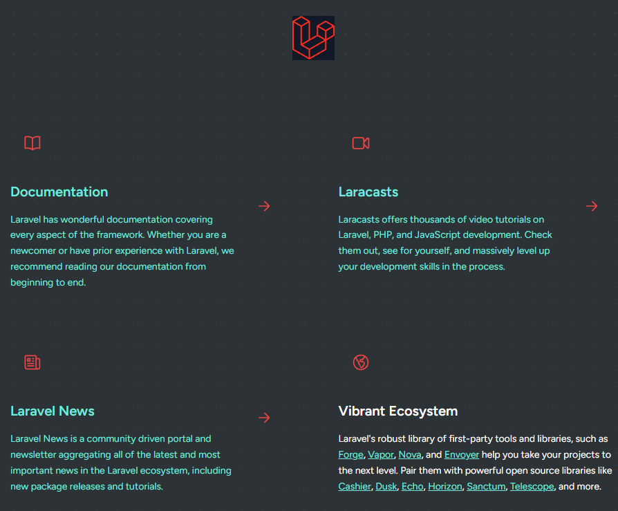
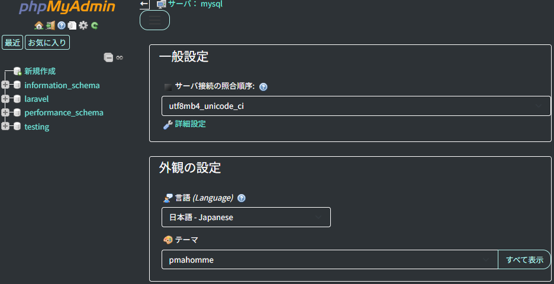

# setup-app-practice

## 概要
COACHTECH 教材 Tutorial 9-1「環境構築ハンズオン」で作成した成果物です。 
Laravel Sail と Docker を使って、Tutorial 9〜10 のハンズオンで使う開発環境を構築しました。

## 使用技術
PHP 8.2 
Laravel 10.x 
Laravel Sail（Docker Compose） 
MySQL, phpMyAdmin

## 学んだこと
・Laravel Sailの環境構築を学んだ。工程とファイルが多く、こんがらがってしまうことが多かった。 
・phpMyAdminの環境構築が苦手で、何度もコーチやAIに頼ることがあった。自分の力で構築出来るようになっていきたい。

## 動作確認
エイリアスを設定する前に起動していたので、 
./vendor/bin/sail up -d　を使ってブラウザで確認した。 
 
